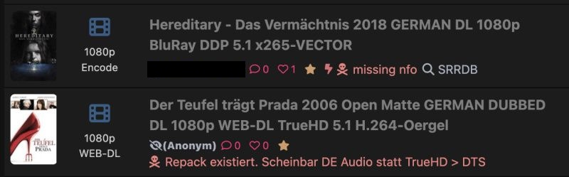

# Unit3d-Trump-SRRDB

A Tampermonkey script that shows trumpable torrent reasons and provides an SSRDB search button.

## What it does

In the torrent list and on the torrent details page, next to the trumpable icon (skull), the script displays:

- **The reason** why the torrent was marked as trumpable (normally only visible on hover)
- **An SSRDB button** that opens an SSRDB search in a new tab (where you can download the missing NFO file if needed)

## Installation

1. Install the [Tampermonkey](https://www.tampermonkey.net/) browser extension.
2. Try installing the script automatically by opening the raw [`Unit3d-Trump-SRRDB.user.js`](Unit3d-Trump-SRRDB.user.js) URL. Tampermonkey should open its install screen. If this fails:
   1. Click the Tampermonkey icon → `Create a new script`
   2. Replace the template content with the contents of [`Unit3d-Trump-SRRDB.user.js`](Unit3d-Trump-SRRDB.user.js).
   3. Save the script (Ctrl+S).
   4. Visit/reload your Radarr/ Sonarr queue page.
3. Configure the script according to the next section

## Menu Commands

The script provides the following Tampermonkey menu commands (click the Tampermonkey icon → script name):

| Menu command        | Description                                                                                    | Default |
| ------------------- | ---------------------------------------------------------------------------------------------- | ------- |
| Show reason         | When enabled, displays the trumpable reason; when disabled, only shows the button (if enabled) | ON      |
| Show button         | When enabled, displays the SSRDB button; when disabled, only shows the reason (if enabled)     | ON      |
| Button only for NFO | When enabled, only shows the SSRDB button (if enabled) when the reason contains "nfo" or "NFO" | OFF     |

## How the search term is determined

The script searches for the first folder name shown on the torrent details page when clicking "Show files". If no folder exists, it falls back to the filename (without extension) from the MediaInfo.

## Disclaimer

This project was realised with the help of LLMs.
